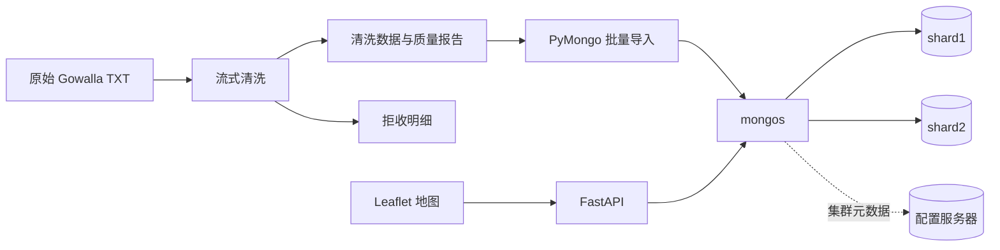

# 社交媒体位置签到数据管理服务系统

> 实现方案与实施计划 v1.1 · 2026-11-19
>
> 依据：《测绘遥感工程实施案例（2026–2027 第 1 学期）》及下发的 Gowalla 签到数据

## 1 任务要求与交付范围

| 任务书要求 | 实施内容 | 验收材料 |
| --- | --- | --- |
| 设计位置签到数据清洗方案 | 读取全量附件，校验字段、隔离异常坐标、去重，以源文件行号追溯 | 清洗规则、拒收明细、质量报告 |
| 设计分布式数据库 | 两个 MongoDB 数据分片，通过 `mongos` 接收写入和查询 | 集群拓扑、分片键与索引、分片计数 |
| 开发数据管理服务系统 | 命令行运行清洗和入库，FastAPI 提供数据服务，地图页面演示查询 | 完整代码、运行说明、接口和页面演示 |
| 用下发附件测试清洗、分布存储和服务 | 全量核对输入、清洗输出、两片持有文档数和查询结果 | 全量运行记录、计数对账、查询执行计划、功能与性能结果 |

每组提交一份不少于 3,000 字的案例设计实施报告及完整系统代码。报告和 PPT 由组长于 **2026-12-02 17:00 前**交助教。PPT 汇报不超过 5 分钟，汇报时间初定 **2026-12-03 18:00**。报告格式按任务书附录执行。见[课程任务书](2026-2027-1测绘遥感工程实施案例.pdf)。

首版服务提供用户轨迹、地图区域签到查询、签到概览和清洗报告。清洗与导入由命令行统一执行。热力图、附近查询、POI 坐标归并及网页触发清洗列为后续扩展。

## 2 原始数据与质量复核

输入使用解压后的 `测试数据loc-gowalla_totalCheckins.txt/Gowalla_totalCheckins.txt` 文件。已按字节核对，工作区的压缩包解压结果与该 TXT 一致。原始文件为 394,645,737 字节，UTF-8 文本，Tab 分隔，无表头，每行五列。

```text
0	2010-10-19T23:55:27Z	30.2359091167	-97.7951395833	22847
```

各列依次为用户 ID、UTC 签到时间、纬度、经度和地点 ID。经纬度以十进制度记录，系统按 WGS 84 处理。GeoJSON 使用 `[经度, 纬度]`，地图组件按其接口转换坐标顺序。附件中没有签到文字或地点名称字段，地点以 ID 展示。

| 指标 | 原始文件 | 按第 4 节规则复核后 |
| --- | ---: | ---: |
| 记录数 | 6,442,892 | 6,442,127 |
| 独立用户数 | 107,092 | 107,069 |
| 独立地点数 | 1,280,969 | 1,280,938 |
| 用户 0 的签到数 | 225 | 225 |
| 用户 776 的签到数 | 2,175 | 2,174 |

原始签到时间范围为 `2009-02-04T05:17:38Z` 至 `2010-10-23T05:22:06Z`。任务书和 Stanford SNAP 数据页标注 6,442,890 条，实际附件比标注多 2 条。报告并列给出标注值与实测值，系统以附件文件读入记录数为对账基准。见 [Stanford SNAP Gowalla 数据页](https://snap.stanford.edu/data/loc-gowalla.html)。

全量扫描确认用户 ID 升序分组、组内时间非增。发现纬度越界 29 条，双零坐标 135 条，完整重复 601 条。双零坐标分布在 18 个地点 ID，其中 116 条集中在地点 17100。本方案把双零记录隔离为疑似无效坐标，保留原文供复核。坐标校验后，按用户、时间和地点分组找到的 601 条重复记录也都属于完整重复，当前附件没有同键但坐标不同的有效记录。

## 3 总体设计



采用 MongoDB 7.0、Docker Compose、Python 3.11、uv、PyMongo、FastAPI 和 Leaflet。数据库进程由 Compose 管理，清洗、入库和 API 在同一主机上通过 `uv run` 运行。Python 依赖在 `pyproject.toml` 声明，提交 `uv.lock`。Leaflet 静态资源随系统提供，底图使用 OpenStreetMap。页面同时提供查询结果列表。

按用户哈希分片使同一用户的记录落在同一分片，轨迹查询可定向到该分片。地图区域查询没有用户分片键，需要访问两片，各片通过空间索引筛选后由路由合并结果。数据库放在一台主机上的两个容器中，各分片有独立持久卷。单成员副本集用于课程演示，两个容器仍共享宿主机的故障域。见 [MongoDB 7.0 哈希分片文档](https://www.mongodb.com/docs/v7.0/core/hashed-sharding/)。

## 4 清洗方案

### 4.1 流程与规则

逐行读取，附上从 1 开始的源文件行号。按下表顺序执行硬性规则，每条拒收记录只记第一个命中的原因。用户切换时释放该用户的去重集合。清洗前同时检查可解析用户 ID 的分组顺序及可解析时间的组内顺序。顺序不符合附件约束时终止任务，输出错误行号。

| 顺序 | 校验条件 | 动作与原因码 | 本附件命中 |
| --- | --- | --- | ---: |
| 1 | 无法按 UTF-8 解码、字段数不为 5 或有空字段 | 拒收，`BAD_STRUCT` | 0 |
| 2 | 用户或地点 ID 不是非负十进制整数，或超过 BSON int64 正数上限 | 拒收，`BAD_ID` | 0 |
| 3 | 时间不符合 `YYYY-MM-DDTHH:MM:SSZ` 或无法解析为有效 UTC 时间 | 拒收，`BAD_TIME` | 0 |
| 4 | 坐标无法解析、为非有限值，或纬度超出 ±90°、经度超出 ±180° | 拒收，`BAD_COORD` | 29 |
| 5 | 经度与纬度均为 0 | 隔离，`ZERO_COORD` | 135 |
| 6 | 用户、UTC 时间、地点及两项坐标解析后均一致 | 保留源文件首条，拒收后续记录，`DUPLICATE` | 601 |

同一用户、时间和地点的记录如存在不同坐标，每组坐标保留在源文件中最先出现的记录，并在质量报告中统计冲突键数量。坐标保留原有数值精度用于入库。低频用户、低频地点和高速位移记录保留，避免因为活动稀疏或相邻点距离大而删除签到。首版以字段合法性、坐标和去重为清洗范围。

### 4.2 输出与对账

| 文件 | 内容 |
| --- | --- |
| `output/clean.tsv` | 有表头，列顺序为 `source_line, user_id, ts_utc, lat, lon, location_id`，按源文件行号输出 |
| `output/reject.ndjson` | 一条拒收记录一行 JSON，包含 `source_line`、`reason_code` 和原始行。无法解码的原始字节用 Base64 保存 |
| `output/quality_report.json` | 输入文件名及 SHA-256、清洗规则版本、清洗文件 SHA-256、输入及输出条数、逐原因拒收数、冲突键数、清洗后用户数和地点数、清洗后 UTC 时间范围及耗时 |

签到数据逐行处理，只在内存中存当前用户的记录键及汇总状态。清洗后用户数在用户组输出时累计，地点数用地点 ID 集合取基数。源文件只读。先写临时输出，全部完成后发布结果，最后写入质量报告作为完成标记。导入前校验清洗文件的摘要与报告一致。

对账式为 `输入条数 = 清洗通过条数 + 拒收条数 = 6,442,127 + 765 = 6,442,892`。表中命中数为直接对附件按相同规则复核所得，系统实现后应重新生成清洗文件和质量报告供验收。

## 5 分布式数据库与导入

### 5.1 集群拓扑

| Compose 服务 | 内部端口 | 角色 |
| --- | ---: | --- |
| `shard1` | 27011 | 单成员副本集 `shard1`，独立卷 `shard1_data` |
| `shard2` | 27021 | 单成员副本集 `shard2`，独立卷 `shard2_data` |
| `cfg` | 27019 | 配置服务器副本集 `cfg`，用于存放分片元数据 |
| `mongos` | 27017 | 统一路由，映射到宿主机 `127.0.0.1:27017` |

各进程通过 Compose 服务名通信，分片及配置服务器端口留在 Compose 网络中。使用教学用本机集群，API 绑定到 `127.0.0.1:8000`。

### 5.2 集合与索引

`gowalla.checkins` 在空集合上按 `{user_id: "hashed"}` 分片。以下为一个 MongoDB 文档示例。

```javascript
{
  _id: 1,
  user_id: 0,
  ts: ISODate("2010-10-19T23:55:27Z"),
  loc: {
    type: "Point",
    coordinates: [-97.7951395833, 30.2359091167]
  },
  location_id: 22847
}
```

`_id` 使用同一批原始数据中的源文件行号，便于复核和重跑。用户 ID 与地点 ID 存为 BSON 整数，`ts` 存为 BSON Date，`loc` 存为 GeoJSON Point。非分片集合 `gowalla.dataset` 保存本次数据的版本标识、状态、质量报告和验收后的分片计数。

| 索引 | 创建时点 | 用途 |
| --- | --- | --- |
| `{user_id: "hashed"}` | 初始化空集合时 | 分片和等值用户路由 |
| `{user_id: 1, ts: -1, _id: -1}` | 数据写入完成后 | 用户轨迹的时间筛选与稳定排序 |
| `{loc: "2dsphere"}` | 数据写入完成后 | 各分片的区域查询 |

### 5.3 全量导入与重跑

1. 导入命令校验清洗文件摘要、数据版本和分片配置。版本由原始文件摘要、规则版本与清洗文件摘要确定。同一集合对应一个固定数据版本，导入状态为 `loading`、`failed` 或 `ready`。
2. 导入程序连接 `mongos`，逐行构造 BSON 日期和 GeoJSON 坐标。每批 5,000 条，通过 PyMongo `bulk_write(ordered=False)` 执行 `UpdateOne`，过滤条件包含完整分片键 `user_id` 及 `_id`，以 `$setOnInsert` 写入其余字段，并启用 `upsert`。相同文件重跑时沿用原有行号。一次只允许运行一个导入任务。见 [MongoDB 7.0 UpdateOne 文档](https://www.mongodb.com/docs/v7.0/reference/method/db.collection.updateone/)。
3. 批量写入出错时记录失败批次、源文件行号范围和原始错误，命令返回失败。同版本可以从头重跑，已写入文档按相同条件匹配。数据版本不匹配时拒绝写入目标集合。
4. 写入完成后创建查询索引并执行第 7 节的计数核验。分片分布、集合总数和质量报告对账通过后写入 `ready`，此时开放查询。日志记录各阶段耗时、已处理、新插入与已存在记录数。

## 6 数据服务与演示页面

### 6.1 接口

| 方法与路径 | 参数与行为 |
| --- | --- |
| `GET /api/health` | 返回数据库连接状态和数据版本加载状态，供页面判断是否可查询 |
| `GET /api/users/{user_id}/trajectory` | 按用户查询签到，支持 `start`、`end`、`limit`、`cursor` |
| `GET /api/checkins/geo` | 按 `bbox=minLon,minLat,maxLon,maxLat` 查询，支持同样的时间和分页参数 |
| `GET /api/stats/overview` | 返回已验收版本的签到数、用户数、地点数、UTC 时间范围和分片计数 |
| `GET /api/quality` | 返回该版本的清洗质量报告 |

时间过滤采用 UTC 半开区间 `[start, end)`，省略单侧时不限制该边界。两类查询均按 `ts DESC, _id DESC` 返回，默认每页 200 条，最多 500 条，以时间和行号构成分页游标。游标只能用于同一类型和同一过滤条件的请求。响应包括 `items` 和 `next_cursor`，界面提示继续加载；合法查询没有结果时返回空列表。参数校验失败返回 HTTP 422，数据库或数据版本未就绪时查询返回 HTTP 503。

空间查询将框选的四角闭合成 GeoJSON 球面多边形，通过 `$geoWithin` 检索，对应边界为球面多边形边。首版只接受经度跨度小于 180°、纬度在开区间 `(-90°, 90°)` 内的非退化范围。前端默认演示城市尺度框选。见 [MongoDB 7.0 空间包含查询文档](https://www.mongodb.com/docs/v7.0/reference/operator/query/geoWithin/)。

### 6.2 展示方式

- 用户轨迹支持输入用户 ID 与时间。签到列表以时间倒序展示，轨迹按时间正序连接已加载的数据点，同时显示当前加载量。
- 地图区域查询支持框选与清除范围，点位弹窗展示用户 ID、地点 ID、坐标与 UTC 时间。
- 概览区展示清洗前后条数、拒收数量和两片持有文档数。分片计数和质量报告注明数据版本。

### 6.3 拟定项目结构

```text
compose.yaml
pyproject.toml
uv.lock
README.md
cleaner/
  pipeline.py
db/
  init_sharding.js
  import_checkins.py
  verify_distribution.js
api/
  main.py
  routes.py
web/
  index.html
  static/
output/
```

`output/` 为本地运行产物。提交材料附质量报告和验收结果，运行说明指向课程下发的数据文件。

## 7 部署顺序与双节点验证

1. 在项目根目录执行 `uv sync --locked` 安装依赖，执行 `docker compose up -d cfg shard1 shard2` 启动三个数据库进程。
2. 在 `cfg`、`shard1`、`shard2` 各自容器中分别连接本地 `mongod`，执行对应的 `rs.initiate()`。成员地址使用 `cfg:27019`、`shard1:27011`、`shard2:27021`，配置服务器副本集额外设置 `configsvr: true`。检查三个副本集均已选出主节点，即 `db.hello().isWritablePrimary` 为 `true`。
3. 执行 `docker compose up -d mongos`，路由使用 `--configdb cfg/cfg:27019`。路由通过 `ping` 后，在 `mongos` 中执行 `sh.addShard("shard1/shard1:27011")` 和 `sh.addShard("shard2/shard2:27021")`，检查两片均已加入，再执行 `sh.shardCollection("gowalla.checkins", {user_id: "hashed"})`。初始化脚本重复运行时检查已有配置及分片键是否符合设计。见 [MongoDB 7.0 集群部署文档](https://www.mongodb.com/docs/v7.0/tutorial/deploy-shard-cluster/)。
4. 运行清洗与全量导入。导入后在 `mongos` 的 `admin` 数据库执行以下聚合，将 `ns` 和 `shards` 原样保存在验收记录中。

   ```javascript
   db.getSiblingDB("admin").aggregate([
     {$shardedDataDistribution: {}},
     {$match: {ns: "gowalla.checkins"}}
   ]).toArray()
   ```

5. 核对 `shard1`、`shard2` 的 `numOwnedDocuments` 均大于零，且 `numOrphanedDocs` 均为零。两片持有文档数之和应等于通过 `mongos` 执行的 `gowalla.checkins.countDocuments({})`，并与质量报告中的清洗通过条数一致。保存实际占比。见 [MongoDB 7.0 数据分布统计文档](https://www.mongodb.com/docs/v7.0/reference/operator/aggregation/shardeddatadistribution/)。
6. 对 `user_id=0` 的轨迹查询执行 `explain("executionStats")`，记录其访问的分片及使用索引。对奥斯汀城市范围查询也保存执行计划，展示两片参与空间检索。数据库验收通过后启动 API 及演示页。

## 8 测试与验收

开发阶段使用保留分组顺序的小样本联调。正式验收使用下发附件全量运行，保存命令、运行环境、质量报告、计数和查询证据。

| 用例 | 核验方法与预期 |
| --- | --- |
| 全量清洗 | 6,442,892 条输入，6,442,127 条通过，765 条拒收；检查拒收原因与源文件行号 |
| 坐标存储 | 找到源文件第 1 行，`ts` 为 BSON Date，`loc.coordinates` 为 `[-97.7951395833, 30.2359091167]` |
| 分布存储 | 两片持有文档数均大于零，两片合计与 `mongos` 精确计数、清洗输出计数三者相等 |
| 导入重跑 | 在联调库中断一次导入，确认查询保持未就绪；重新导入同一文件，最终计数一致且无重复写入 |
| 用户轨迹 | 用户 0 在无时间过滤下有 225 条，用户 776 有 2,174 条；以小页翻页核对条数、排序和无重复。用户 0 的执行计划只涉及一片 |
| 区域查询 | 用奥斯汀范围 `-97.81,30.22,-97.74,30.30` 与 UTC 区间 `[2010-10-19T23:55:27Z, 2010-10-19T23:55:28Z)` 查询，结果应包含源文件第 1 行；核对两片参与查询 |
| 统计概览 | 页面及 API 与验收计数一致，展示 107,069 个用户、1,280,938 个地点，清洗报告可追溯 |
| 参数边界 | 非法时间、反向经纬度范围、越界页大小返回 HTTP 422；合法的无结果查询返回空列表 |

性能报告记录清洗总耗时、数据写入耗时与吞吐、索引构建耗时和索引大小。查询测试预热后，在固定环境顺序执行 100 次用户轨迹请求和 100 次城市范围请求，分别记录 P50、P95、错误数及请求范围与时间分布。附上机器配置、MongoDB 版本、请求页大小及原始结果。分片实际占比、磁盘占用和延迟在集群运行后填写。

## 9 分工与进度

| 日期 | 分工与里程碑 | 交付证据 |
| --- | --- | --- |
| 11-18 至 11-20 | 组长统筹方案与接口，清洗组员和数据库组员确认输入、输出、计数契约 | 方案与样例数据，逐项分工 |
| 11-21 至 11-25 | 清洗组员完成全量扫描，数据库组员完成两分片部署、导入和索引 | 质量报告、全量入库日志、双分片计数 |
| 11-26 至 11-28 | 后端组员联调轨迹与空间查询，前端组员接入地图与概览 | 可运行服务、演示页面 |
| 11-29 至 12-01 | 测试与文档组员汇总证据，全员复核报告和 PPT，组长组织汇报演练 | 功能与性能结果、报告、完整代码、PPT |
| 12-02 17:00 前 | 组长提交报告与 PPT，按课程要求提供完整系统代码 | 提交材料 |
| 12-03 18:00（初定） | 小组汇报 | 5 分钟内讲清设计、实施和结果 |


## 10 实施中需提前确认的条件

| 条件 | 核验方法 |
| --- | --- |
| 本机能启动两个分片和配置服务器 | 提前启动集群，确认三个副本集均可选主，`mongos` 能连接两片 |
| 导入阶段磁盘和内存充足 | 在开发样本导入后记录卷占用和进程内存，估计全量资源，写入及索引构建阶段分别计时 |
| 数据处理可追溯且可重跑 | 保存原始文件摘要、质量报告、拒收明细和失败批次，在联调库验证同版本重跑 |
| 演示可在规定时间内完成 | 固定演示用户、奥斯汀范围和展示流程，报告和 PPT 中保留经过验证的关键结果 |

## 附录 A 运行命令约定

以下命令对应拟实现的入口，在项目根目录执行。数据库初始化按第 7 节完成后，再运行清洗与导入。

```powershell
uv run python -m cleaner.pipeline --input "测试数据loc-gowalla_totalCheckins.txt/Gowalla_totalCheckins.txt" --output output
uv run python -m db.import_checkins --input output/clean.tsv --report output/quality_report.json --uri mongodb://127.0.0.1:27017
uv run uvicorn api.main:app --host 127.0.0.1 --port 8000
```

服务启动后通过 `http://127.0.0.1:8000/` 打开演示页，通过 `/docs` 查看 API 文档。验收时使用数据库脚本与质量报告复核数据版本和条数。
